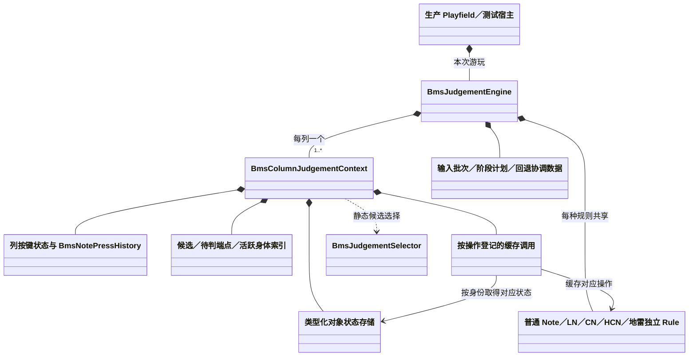
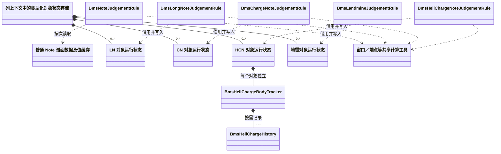
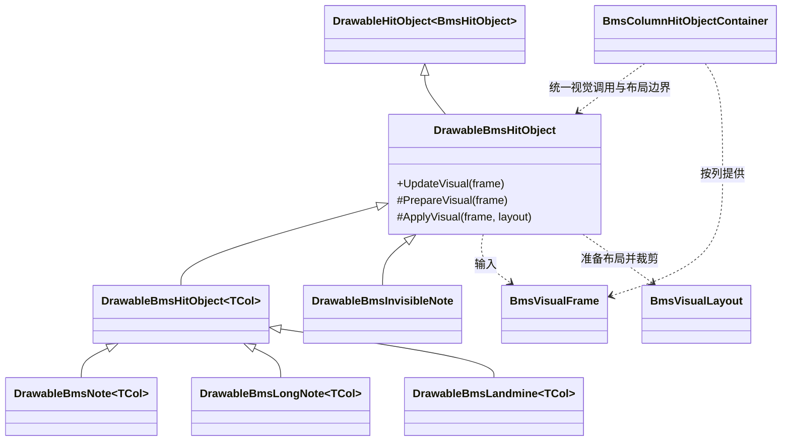

# HitObject 判定与绘制完整实现方案

[返回开发文档](development.md)

更新：2026-10-01。按最新实施要求，先完成核心、Mod 和所有生产消费者的重构，持续提交中间态；测试迁移、Git 旧版对照及验收统一放在重构完成后。

<a id="implementation-start"></a>

## 当前实施入口

**完整实现核心 → Mod 与生产消费者迁移 → 统一迁移测试及 Git 旧版对照 → 最终验收。**

本次调整以生产实现为先，不为运行尚未迁完的测试增加中间适配层。以下行为、架构和性能要求保持为最终验收条件，不作为中间提交或 Mod 迁移前的测试门槛。

当前在 `codex/hitobject-judgement-refactor` 分支继续实现核心。独立 LN/CN/HCN 规则、类型化状态、按操作绑定及地雷规则已接入生产；多列引擎接受数值帧和输入批次。列上下文已移除 Drawable、容器及图形时钟依赖，表示绑定与生命周期通知归入现有输出适配。各绘制子类组合自己的图形，容器提供共享视觉帧，由长按计算头尾布局。纯视觉观测已独立登记并按表示代次解绑，布局读取固定头位置和方向历史。收尾去重已从 `LastPostTime` 迁到绑定内的调度代次/模拟步骤。生产 Release 构建及 634 项定向回归通过。

核心尚未完成：统一布局准备/应用契约已接入，仍需迁移剩余旧检查点测试，并补齐完整调度矩阵。无自动化调度记录器已迁移，真实键盘和回放生成的逻辑轨迹与原 fixture 一致；Note、LN、CN、HCN 执行测试已改为正式框架出口与记录出口对照。完整测试项目仍受剩余旧 Controller 记录器、旧表现接口的消费者阻塞；本次局部测试通过不代表整个测试项目已恢复。AutoScratch 已迁到核心模拟步骤，Mod 注册已恢复，尚未构建或测试；Git 旧版完整对照及性能验收均待全部生产重构完成后进行。

快速导航：[实施顺序](#implementation-order) · [目标架构](#target-structure) · [生命周期](#state-lifecycle) · [调度](#scheduling-contracts) · [Git 对照](#git-comparison) · [验收](#behaviour-acceptance) · [验证命令](#verification-commands) · [完成条件](#completion)。

<a id="git-baselines"></a>

### Git 基线

| 版本 | 用途 |
| --- | --- |
| 重构前行为基线 | `d4e690cd3f8fadc70fe2d82021f338a012e1980e`；完整核心的行为对照版本 |
| 原有工作检查点 | `e2315b28aa614220b937344c06dc21cf3663a6c9`；持久引用 `codex/hitobject-before-direct-implementation`，保留原实现、测试和未压缩历史 |
| 压缩后基点 | `a209acb1a39ebb7e001da5eb27c37dc5759afd2d`；与检查点文件树相同 |
| 独立规则中间态 | `d00a59fb31a55d2725f44406fd33f41d42e68d97`；保存独立长按/地雷规则和多列帧引擎，后续继续职责与测试迁移 |
| 表示与图形分离中间态 | `378e7035887b5704615c8278e2b2a6d135ce8053`；保存独立表示绑定、图形组合及 466 项已迁移测试 |
| 核心实施分支 | `codex/hitobject-judgement-refactor`；继续完整核心实现，对照前固定待验证版本的 commit |

<a id="implementation-order"></a>

## 剩余实施顺序

### 1. 完整实现核心设计

一起完成普通 Note、LN/CN/HCN、地雷、输入/回放、运行状态、索引、结果输出、生命周期、只读表现及独立调度。规则与表现、索引与调度、调用方与被调用方按同一套最终契约实现，复用现有几何、皮肤、计分和音频逻辑。

核心完成时，无 Mod 的真实 Player 和无 Drawable 的完整引擎使用同一套规则与调度。操作绑定、统一结果出口及框架结果/生命周期适配只承担最终架构中的职责。开发中可以按依赖顺序编码、小提交和定向单测；不要求中间版本单独可游玩，不增加受限模式、运行时新旧开关或供旧测试调用的兼容层。保留行为断言并迁移到最终入口。

### 2. 完成 Mod 与生产消费者迁移

核心入口稳定后直接迁移 AutoScratch/Autoplay 等受影响 Mod、相关注册与生产消费者。基于对象身份和稳定核心入口恢复自动持有与采样，明确 AS-1 的语义及行为变化，同步玩家文档和本地化。此阶段不恢复旧接口，也不为旧测试增加临时路径。

### 3. 统一迁移测试、对照与最终验收

全部生产重构完成后，将剩余测试直接迁到最终入口，再按[Git 对照流程](#git-comparison)运行重构前版本和新实现，补齐行为、框架、表现与性能证据。直接在新规则、调度或正式框架适配中修正差异，直至满足完成条件。

保持已记录的玩法语义、时间边界和同步观察顺序。RA-1/ST-1 等基线行为按事实对照；有意行为修复单列原因和前后证据，原 fixture 保留原始预期。

统一验证核心行为、Mod、回放、表现和性能组合，满足[全部完成条件](#completion)后最终集成。benchmark 仍需事先取得用户同意。

## 目标与范围

- 每个 playfield 使用一个 `BmsJudgementEngine`，内部按列维护上下文；普通 Note、LN、CN、HCN、地雷分别使用独立判定规则。
- 引擎拥有自定义判定状态与调度；Drawable 负责表现及必要的框架结果适配。
- `DrawableBmsHitObject` 只定义所有类型共同需要的绑定、框架结果桥接、布局与裁剪契约；具体图形结构由子类组合，基类不暴露长按、地雷或输入操作。
- 按真实消费者定义接口契约；类型化数据、具体规则和共享组件保留具体类型，接口只承担可替换输出或框架边界职责。
- 规则通过谱面对象身份访问运行状态，直接接受输入和模拟时间；表现层读取只读状态，绘制更新不推进判定。
- 摘除自定义判定状态与 `BmsHitObjectLifetimeEntry` 的耦合，状态在 Drawable 回池后继续有效。
- 保持判定目标、窗口边界、事件时间与顺序、计分、血量、回放、暂停恢复、音效与视觉反馈一致。
- 在相同负载下保持或降低判定耗时、稳态分配和内存占用，并保留现有绘制延迟更新优化。

本次重构保持现有判定算法、LN/CN/HCN 语义、回放格式和音频路由。若发现现有行为缺陷，单独记录并安排修复，不在行为等价迁移中顺带修改。

<a id="mod-scope"></a>

**核心与 Mod 边界。** 先完整实现普通玩家/普通回放所需的规则、表现、地雷、独立调度和框架适配，再迁移 Mod 和生产消费者，最后统一对照验证。Scratch 双方向、反向尾、重按、长按、HCN 身体、暂停及回退都是核心范围。核心入口稳定后继续实现 AutoScratch 等 Mod 的入口、自动持有与采样适配。

无 Mod 的真实 Player 必须可构建运行，用于完整核心对照。AutoScratch 消费者及注册基于稳定核心入口恢复；最终发布要求全部应支持的 Mod 通过集成验收。自动持有的基线行为保留用于对照，Mod 采样语义及有意变化在迁移中明确记录。

<a id="target-structure"></a>

## 目标结构

```text
BmsPlayfield
  | 收集玩家/普通回放输入，提供时钟及游玩上下文
  v
BmsJudgementEngine (每个 playfield 一个)
  +-- 全局阶段顺序、输入批次、暂停及回退协调
  +-- BmsColumnJudgementContext[]
  |     +-- 按键方向、按键历史、按对象身份维护的候选与活跃索引
  |     +-- 规则绑定及每个对象的运行状态/历史
  |     +-- BmsJudgementSelector
  +-- BmsNoteJudgementRule           普通 Note
  +-- BmsLongNoteJudgementRule       LN
  +-- BmsChargeNoteJudgementRule     CN
  +-- BmsHellChargeNoteJudgementRule HCN
  +-- BmsLandmineJudgementRule       地雷
  +-- 按能力登记：按下、被动、长按操作、身体、经过、回退
  +-- 内部执行上下文：协调状态检查点，维护索引及阶段成员
  | 在原检查点同步调用外部适配；替换出口不替换内部协调
  v
IBmsJudgementOutput / 当前表示适配
  +-- Drawable 薄适配 -> ApplyResult -> 框架计分与回退链
  +-- 合成端点、非消费判定、HCN tick -> 现有计分与回退路径
  +-- 只读状态通知 -> 表现映射及即时反馈
  +-- 框架结果提交/撤销检查点 -> 引擎拥有的索引维护回调

只读玩法状态 + 按住状态 + 时间
  -> 绑定时选择的 LN/CN/HCN 表现策略
  -> BmsLongNotePresentation (值类型表现数据)
  -> 共用 DrawableBmsLongNote / 几何 / 身体分段 / 皮肤

DrawableBmsHitObject (框架适配与通用视觉契约)
  +-- DrawableBmsNote         点状音符图形
  +-- DrawableBmsLongNote     LN/CN/HCN 共用的头/身体/尾图形
  +-- DrawableBmsLandmine     地雷图形与表现
  +-- DrawableBmsInvisibleNote 可选的标记图形

BmsColumnHitObjectContainer
  +-- 生命周期、池化、定位、裁剪、绘制批处理
  +-- 登记/解除当前表示，并向引擎报告激活和移除边界
  +-- 每列提供共享视觉帧，消费对象报告的布局边界
  +-- 绘制读取表现数据，不调用按下、被动或身体判定

BmsHitObjectLifetimeEntry
  +-- 生命周期计算、框架基类 Result
  +-- 通过无状态规则获取激活/回收所需窗口
```

以上是目标结构，新增名称不代表已经存在实现。结果适配和表现策略可以用内部方法或无状态函数实现，不要求逐对象创建服务。规则实例在同一游玩内共享；窗口缓存、释放历史和身体累计属于具体对象的运行状态。

**关系图约定。** 上面的概览表达职责与数据流；继承、持有和使用依赖由静态关系图及所有权表明确。关系图描述迁移完成后的约束，不能作为现实现已经符合的证明。

- `Base <|-- Derived`：继承，箭头指向基类；接口实现另用 `Contract <|.. Implementation`。
- `Owner *-- Part`：主体负责成员实例或成员集合的生命周期；共享组件实现不表示共享同一个可变实例。
- `Client --> Service`：引用或借用已有对象，不据此取得其生命周期所有权；绑定期引用须说明解除时点。
- `Client ..> DataOrTool`：参数、只读数据、值类型或静态工具的使用依赖，不要求保存对象引用。

图中的职责名称不要求逐一创建新类或接口。继承关系不能仅为复用某块图形而扩展；可变状态和图形组件的持有者、跨边界引用的有效期应与“状态与生命周期”一节一致。

### 引擎、列上下文与类型规则

- 引擎统一处理全列阶段；列上下文只查找本列对象，不自行跑一套完整帧循环。
- `BmsJudgementSelector` 继续负责同列跨类型候选选择。选中目标后，上下文直接调用该对象已绑定的规则，不经 `Drawable.TryHit()` 再转回上下文。PMS 非消费 BAD、E-POOR 和按键历史仍在原列级选择流程处理。
- LN、CN、HCN 各自拥有完整的状态转换、端点结算及回退语义。三个规则使用组合共享计算组件，不让 HCN 继承 CN 的判定流程。
- 普通 Note 处理按下与被动漏判；三种长按规则处理头尾、重按、释放、暂停结算及自身回退；只有 HCN 注册身体更新能力；地雷处理经过。
- Invisible Note 保持独立的 keysound 时间线，不进入计分候选。
- 规则按阶段操作登记，不使用一个带通用事件类型和内部 `switch` 的万能 `Process` 接口。“有一种操作”不等于“新增一个接口”；长按操作、HCN 身体和回退通过具体规则绑定接入，普通 Note 不提供这些操作的空实现。
- 每种对象的规则在初始化或登记时确定，热点路径避免反复类型分派、临时委托和对象分配。
- Engine/列上下文的初始化输入为谱面数据、列配置和结果/反馈出口；不要求构造真实 Playfield、Column 或图形时钟。Playfield 适配提供时间值和生命周期通知，列级音效请求经反馈出口代理到现有音频路径。
- 玩家和普通回放适配调用核心引擎入口，保留输入时间、方向、批次次序及反馈时点。核心入口稳定后，继续适配 AutoScratch 等 Mod；定向操作和采样语义在 Mod 工作中决定，不以旧 Mod 调度反向规定核心接口。

| 调度操作（示意，不逐项新增接口） | 调用方与输入 | 实现规则 |
| --- | --- | --- |
| `TryPress` | 已选对象运行状态、结果、输入时间、模拟时间、方向、速率及同步出口 | 普通 Note、LN、CN、HCN |
| `CheckPassive` | 对象运行状态、模拟时间及同步出口；在已记录的被动检查边界调用 | 普通 Note、LN、CN、HCN |
| `TryRepress` / `TryRelease` / `CompleteAtPause` | 列上下文选目标，具体绑定调用对应规则的方法 | LN、CN、HCN |
| `UpdateBody` | 模拟时间、elapsed、本批最终物理按住状态及自动按住状态 | HCN |
| `CheckPassing` | 模拟时间与本批最终物理按住状态 | 地雷 |
| `Rewind` | 对象运行状态与回退时间，协调顺序由引擎决定 | LN、CN、HCN、地雷 |

表内方法属于具体规则，按登记阶段调用。`BmsPressContext`、`BmsReleaseContext`、`BmsFrameContext` 等值类型分别携带操作所需的时间与输入，不传 Drawable、Column 或 Clock；输入时间与模拟时间保持区分。`UpdateBody` 中已有自动按住输入是现有语义，不意味着核心阶段须设计 Mod 采样；核心对照使用普通物理按住路径。对象运行数据按类型存储，不要求为每个普通 Note 增加堆对象。框架主结果状态由出口提供只读查询，普通 Note 仍可使用谱面对象及值类型缓存。

引擎持有状态，规则是该类型状态的唯一写入者；列索引和表现层只查询语义状态。身体、待判端点和可见对象分别维护需要的活跃范围，不再共用一个同时表示判定和视觉存续的长按标志。

**操作绑定方案。** 采用按操作登记的缓存调用，不将 `BmsRuleBinding` 实现为所有类型共用的大型委托包，也不按类型整批执行混合对象：

- 每列、每种规则建立共享的具体调用适配，适配引用列上下文拥有的该类型状态存储并缓存方法组委托。规则本身接受具体类型的状态；热点路径不使用 `object`、`DynamicInvoke` 或按模式强转。重复的存储/登记代码确有需要时才提取泛型工具。
- 对象登记是值类型记录，包含稳定对象身份、状态槽位及共享操作绑定；普通 Note 复用谱面对象索引，不创建独立的可变状态堆对象。注册工厂保证槽位和对应类型存储匹配。
- 按下、被动、重按/释放等各自登记实际支持的操作；未支持的对象不进入该操作的登记表。一次候选选择仍只产生一个目标，再调用该目标的操作；能力登记不改变候选胜出规则。
- HCN 身体和地雷经过各自只有一个具体实现，活跃阶段直接调用对应规则。混合被动计划按原顺序保存对象 handle，通过已登记操作调用规则；共享委托数量随列数和规则种类增长，不随音符数、输入数或帧数增长。
- 当前按下/被动接口的消费者一并迁至这些操作登记；无剩余消费者时删除接口。类型专有数据继续保留具体类型，不为减少接口改成弱类型消息。

### 判定系统的所有权与依赖关系

以下关系描述目标设计，沿用前述继承、持有、引用和使用依赖图例。图中的“各类型 Rule”“类型化状态存储”“操作登记”和“执行上下文”是已定义职责的展示，不要求新增统一 Rule 基类、RuleSet 服务或逐音符包装对象。静态关系图不表达同步执行先后；结果提交、状态发布及回退顺序仍以对应检查点契约为准。

**引擎、列上下文与共享规则。** 宿主创建并管理本次游玩的引擎；引擎持有列上下文、共享规则实例及全局调度数据。列上下文拥有本列的输入状态、索引、对象运行状态和操作登记，绑定只引用共享 Rule 及对应状态存储。选择器保留静态工具依赖。



**具体 Rule 与逐对象状态。** 五种 Rule 相互独立，不通过继承或互相调用复用结算流程。规则每次操作借用对应状态，状态的存储和生命期仍由引擎的列上下文管理。普通 Note 使用谱面数据和必要的值缓存；框架主结果查询通过下一图的执行上下文/出口完成，不为普通 Note 增加独立可变状态堆对象。



LN 的暂存头端点，以及 LN/CN/HCN 各自的释放记录，属于对应对象的运行状态；三种规则可以复用历史记录实现，但不共享同一个可变历史实例。HCN Rule 调用该对象持有的身体累计器，不在共享 Rule 上保存累计或历史。图中的状态持有关系表示逻辑所有权，具体采用值类型存储还是按需对象存储仍以现有分配约束为准。

**内部执行上下文与可替换结果出口。** 引擎使用宿主注入的出口，规则借用一次操作的执行上下文。执行上下文协调内部索引与外部输出；生产适配和记录适配实现同一个出口接口，均不拥有列索引。生产适配借用框架服务及当前表示登记，记录适配维护独立的测试主结果存储。

```mermaid
classDiagram
    direction TB

    class BmsJudgementEngine
    class BmsColumnJudgementContext
    class ConcreteRule["当前操作对应的具体 Rule"]
    class ExecutionContext["内部执行上下文（调用期）"]
    class IBmsJudgementOutput {
        <<interface>>
    }
    class ProductionOutput["生产结果适配"]
    class RecordingOutput["记录结果适配"]
    class FrameworkServices["框架结果／计分／血量及反馈服务"]
    class RepresentationBindings["当前表示登记（对象身份与代次）"]
    class DrawableBmsHitObject
    class RecordedResults["测试主结果存储与观察记录"]

    BmsJudgementEngine --> IBmsJudgementOutput : 注入的出口
    ConcreteRule ..> ExecutionContext : 查询结果及请求同步操作
    ExecutionContext --> BmsColumnJudgementContext : 借用并协调内部索引
    ExecutionContext --> IBmsJudgementOutput : 借用并调用外部适配
    IBmsJudgementOutput <|.. ProductionOutput
    IBmsJudgementOutput <|.. RecordingOutput
    ProductionOutput --> FrameworkServices : 借用现有路径
    ProductionOutput --> RepresentationBindings : 查询当前表示
    RepresentationBindings --> DrawableBmsHitObject : 仅当前绑定代次
    ProductionOutput ..> DrawableBmsHitObject : 同步主结果薄桥接
    RecordingOutput *-- RecordedResults
```



| 关系 | 所有权与有效期 |
| --- | --- |
| 引擎持有列上下文、规则及调度数据 | 本次游玩；Rule 实例共享，各对象的可变状态由列上下文存储，规则不长期捕获某个对象状态 |
| 列上下文持有索引及对象状态 | 对象以稳定身份关联；索引只维护其所需活跃范围，状态/历史按回退需求保留，不随 Drawable 回池删除 |
| 操作登记引用 Rule 和类型化存储 | 复用共享调用；对象登记只保存身份、槽位及相应绑定，不保存池化 Drawable 或每对象闭包 |
| Rule 借用执行上下文和类型化状态 | 一次同步操作内有效；只有对应规则写该类型玩法状态，执行上下文维护派生索引而不重新决定类型语义 |
| HCN 对象状态持有累计器与历史 | 每对象独立，按对应回退/暂停规则恢复；其他类型不创建 HCN 身体状态 |
| 引擎引用生产或记录出口 | 宿主选择并管理出口生命期；替换出口不替换索引算法、目标选择或阶段计划 |
| 生产出口借用框架服务和表示登记 | 框架主结果仍归原框架链；表示登记由宿主的框架适配层管理，Reapply 替换代次，真正移除完成末次检查后解除引用 |
| 记录出口持有测试主结果 | 模拟权威结果查询及同步提交/撤销观察点；不另行实现规则、派生索引或调度算法 |

框架生命周期适配通过对象身份向引擎报告激活、重应用、移除和恢复边界；输出适配调用注入的同步结果检查点回调，索引算法仍归引擎/列上下文。两者均不在规则中暴露 Drawable。跨层的表现映射只读取语义状态并产生表现值，不能反向调用 Rule 推进判定。Invisible Note 继续使用独立 keysound 时间线，不因该关系图增加一个空判定 Rule。Mod 适配在这些核心关系之外使用稳定入口；适配不取得规则、状态或调度所有权，最终实现不含旧协议转发层。

### 接口与操作边界

LN/CN/HCN 使用三个具体 Rule，其运行状态、端点、表现数据及几何组件保留具体类型。接口只用于确有共同消费者的可替换实现或必须隔离的框架边界。

| 职责 | 最终契约 |
| --- | --- |
| 输入、重按、释放、暂停及回退 | 通过对象身份进入引擎，按具体操作登记缓存调用；按下/被动接口的剩余消费者统一迁入这一分派机制 |
| HCN 身体与地雷经过 | 使用具体规则和组件，通过操作登记参与调度 |
| 框架结果、计分及血量 | 通过共用 `IBmsJudgementOutput` 同步适配；内部索引仍由引擎协调 |
| 长按表现 | 类型化只读表现值驱动具体 Drawable，测试分别查询运行状态和图形 |
| 视觉时间观测 | 复用具体视觉状态组件和绑定时缓存的观测调用，按需登记与解绑 |
| 命中灯 | 消费 `BmsHitLightStyle` 等已决定的表现值；资源选择归表现映射及皮肤适配 |

必要的跨框架可替换出口采用一个 `IBmsJudgementOutput`，由生产适配及记录测试适配实现。它提供框架主结果的只读查询，并表达主结果提交、补充计分、血量效果、只读状态通知和必要反馈请求，以对象身份和类型化数据传递。使用明确操作，保留各计分路径；不将所有事件装进一个 `Process(event)`，也不把原 LN sink 的全部方法改名搬入公共接口。出口不持有或修改候选、待判端点及活跃身体索引。

规则通过引擎提供的具体执行上下文调用 `PublishState(objectId, context)`，不直接把内部索引通知交给可替换出口。执行上下文在规定检查点同步刷新只读表现，再由引擎重新计算该对象的索引成员和截止时间；记录出口可以不生成任何图形，内部索引更新仍然执行。公开出口不增加 `OnHellChargeHeadPoor`、`KeepLongNoteAlive` 等模式专用方法。`BmsLongNoteEndpointResult` 等领域数据仍可存在，LN 专有数据不需要为消除名称而泛化。

核心实现同时消除列上下文的 LN Drawable 强转、测试对旧绘制接口的判定查询以及所有过渡分派。Mod 后续直接接入最终契约，不能借旧接口或同义转发恢复耦合。真实需要的皮肤来源、HUD 事件和框架规定的接口继续保留，接口数量本身不作为完成指标。

<a id="state-checkpoints"></a>

### 内部状态检查点与输出适配

执行上下文是引擎提供的内部具体上下文，可用值类型传参；它只协调索引和同步调用，不保存第二份玩法状态、不判断 LN/CN/HCN，也不新增公共接口。规则决定何时改变其状态、何时提交结果及何时发布状态；引擎从规则的只读语义查询计算派生索引。

| 检查点 | 执行责任及顺序 |
| --- | --- |
| 自定义状态改变 | Rule 写状态 -> `PublishState` 同步通知只读表现 -> 引擎更新该对象的索引/截止时间 -> 返回 Rule |
| 框架主结果提交 | 表示适配保留原框架通知链，在原结果观察位置调用引擎拥有的索引维护回调；不能全部延迟到提交方法返回后 |
| 框架撤销通知，结果尚未清空 | 保留 `RevertResult`、entry/Drawable 撤销通知及 `ArmedState.Idle` 的原顺序；只读主结果仍能查到旧结果，不能提前清空或假定恢复已经完成 |
| 撤销后的派生状态收敛 | 框架 `result.Reset()` 及自定义历史恢复完成后，在原恢复边界重建索引；后续玩家/普通回放选目标使用恢复后的状态，保留核心输入与回退检查点的原相对顺序 |
| 普通 LN 头成功但未提交主结果 | 仍执行内部状态检查点，按既有语义更新候选及持有索引；不等待 `OnNewResult` |
| 移除中的对象 | 允许最后一次同步结果和表现通知；索引更新识别移除状态，不重新加入候选或身体阶段 |

主结果只读查询在生产中读取框架权威结果；记录适配维护测试用主结果存储，并模拟相同的同步提交/撤销检查点。两种适配都通过同一套引擎索引逻辑；记录适配不能只是忽略主结果状态的日志 sink。框架回调与 `PublishState` 即使都请求索引刷新，也只能幂等维护成员，不重复提交结果或累积身体。

**撤销的两个观察时点。** 当前框架先发送 `RevertResult` 和 `entry.OnRevertResult()`，后执行 `result.Reset()`；Drawable 在 entry 的通知中先更新为 `ArmedState.Idle`，再发送自身的 `OnRevertResult`。记录适配复现这一顺序，不实现为“先清空，再通知”。撤销回调内的索引处理仍由引擎负责，但不能仅按尚未清空的主结果重算一次就结束恢复。使用现有后续恢复阶段完成自定义状态及派生索引收敛，不为此另加一套公共撤销接口。验收分别断言通知内部的旧结果/查询语义，以及结果清空和历史恢复后、后续目标选择前的查询结果。

外部观察者保留原同步位置；观察者产生的新输入按既有输入入口收集，不在通知栈中递归启动另一轮引擎调度。以上顺序的验收观察点包含主结果状态、尾状态及候选/持有/身体的查询语义，不能只比较方法返回后的快照。新旧索引结构可以不同，对照的是可选目标、可执行操作及其顺序，不要求物理容器成员逐项相同。

### 三种长按规则与共享组件

| 决策 | LN 规则 | CN 规则 | HCN 规则 |
| --- | --- | --- | --- |
| 成功头判定 | 暂存头端点，最终结算时提交 | 立即提交头结果 | 立即提交头结果，启动身体状态 |
| 尾判定 | 按原算法综合头尾；持续按住可在尾时刻自动完成 | 独立尾结果，保留键盘释放和 scratch 反向触发语义 | 独立尾结果，并更新身体后续效果的依据 |
| 被动头 POOR | 提交主结果并完成判定 | 提交头结果及合成尾 POOR | 保留原合成头尾路径，同时允许身体继续生效 |
| 提前成功判尾后 | 完成持有流程 | 完成持有流程 | 按原时序继续处理剩余身体效果 |
| 暂停与回退 | 恢复暂存头、释放记录和尾状态 | 恢复独立头尾与释放记录 | 额外恢复身体累计；暂停完成后停止身体效果 |

共享窗口表、端点数据结构、方向表示和释放历史记录。PMS 释放宽限的计时机制可以复用，宽限到期后的结算仍由各规则决定。HCN 组合现有 `BmsHellChargeBodyTracker` / `BmsHellChargeHistory`；其他模式不创建身体历史。允许少量相似流程，避免通过一组模式布尔参数重新构造总控制器。

### 运行状态与查询

每个长按按谱面对象身份关联独立运行数据，包含下列语义维度；具体字段及存储布局在实现时选择，不要求将它们变成一个所有模式都持有全部字段的大对象。

| 状态维度 | 内容及归属 |
| --- | --- |
| 头端点 | 是否已处理、结果、实际判定时间、offset、scratch 方向；三种规则独立写入 |
| 尾端点 | 是否已处理、结果、实际判定时间；与身体是否有效分开 |
| 待结算释放 | 释放时间及回退记录，支持 PMS 重按取消 |
| LN 暂存结果 | 尚未提交的头端点，仅 LN 需要 |
| HCN 身体 | 是否仍有效、累计、上次身体更新时间和回退历史，仅 HCN 需要 |
| 框架主结果 | 通过结果适配查询，不在运行数据里复制一个 `Judged` 标志 |

规则暴露只读查询，例如 `HasPendingHead`、`CanRepress`、`HasPendingTail` 和 `HasActiveBody`。候选选择仍保留“普通 LN 头已处理但主结果未提交”的原有语义，不因查询拆分提前排除重叠长按。HCN 允许尾已判定而身体仍有效；索引分别按这些语义维护。用端点时间和历史恢复状态，不通过 Drawable 的 Alpha、寿命或固定头位置推断玩法状态。

<a id="state-lifecycle"></a>

### 状态与生命周期

| 数据 | 唯一归属 | 生命周期 |
| --- | --- | --- |
| 谱面时间、列、音效与预计算滚动数据 | `BmsHitObject` 及谱面处理流程 | 谱面 |
| 按键方向、候选索引、`BmsNotePressHistory` | 引擎的列上下文 | 本次游玩 |
| 类型化运行状态、长按历史、地雷经过时间 | 引擎按谱面对象持有，由对应规则写入 | 支持回退的本次游玩，按需创建 |
| 主 `JudgementResult`、框架已判定状态及主结果回退栈 | 现有框架 entry/playfield 链 | 由框架管理 |
| 合成端点、非消费判定和血量历史 | 现有计分/血量及 playfield 回退路径 | 由对应路径管理，引擎协调调用 |
| 当前位置、固定头、身体几何、透明度及动画 | Drawable/绘制组件 | 当前表示绑定期间 |
| 固定头/身体样式/退场等表现数据 | 表现策略由只读玩法状态投影，使用值类型 | 在原同步反馈点及必要的表现更新时间重算 |
| 活跃 Drawable 关联 | 登记适配，供引擎同步提交结果 | 当前绑定代次；重应用时替换，真正移除时解除 |

引擎持有的长按和地雷状态不引用 `BmsHitObjectLifetimeEntry`，也不长期捕获池化 Drawable。框架是否已经提交主结果，由适配提供查询；避免在引擎内复制一个与 `Entry.Result` 并行的已计分标志。

谱面对象身份与排序键分开处理。候选、端点及身体索引使用对象身份或稳定 handle，不存池化 Drawable；表示映射单独管理。基线轨迹使用稳定谱面编号，允许时间和列相同的多个对象。迁移期间保留现有候选及同帧遍历的胜出顺序，不因改用 handle 或重建索引增加新的排序规则。

生命周期适配分别处理三种条件，不用一个 `Alive` 或 `Judged` 代替：

| 条件 | 来源与用途 |
| --- | --- |
| 判定活跃 | 规则给出的静态输入/被动窗口，加当前端点、释放和身体状态；决定候选、待判端点及身体阶段成员 |
| 表示需要存续 | 生命周期适配合并判定所需区间与既有视觉寿命；在整个判定活跃区间保留框架表示，保证同步主结果及反馈可用 |
| 当前可见 | 表现策略、布局边界和视口；决定是否应用昂贵图形更新，不能直接决定退出判定或回池 |

entry 通过规则提供的无状态判定窗口保证最早输入前激活，生命周期适配结合只读状态保留最后一次被动检查机会。保留原激活范围、寿命余量及合法的提前退场条件；CN 主结果已提交或 HCN 尾已处理不能单独触发回池。没有活跃表示时，只保留可回退状态，不继续执行需要框架表示的操作。

**绑定、重应用与移除协议。** 稳定对象身份用于玩法状态，绑定代次用于识别当前池化表示；二者独立。代次在每次绑定时递增，纯视觉观测登记也记录代次，旧绑定的通知不能影响复用后的 Drawable。`OnFree` 表示解除本次表示绑定，不能单独证明对象已经退出判定生命周期；真正移除由容器移除及末次检查边界驱动。

| 边界 | 必须完成的顺序 |
| --- | --- |
| 激活 | 先完成当前时间的状态恢复 -> 绑定对象身份/代次和框架表示 -> 重建表现并登记必要视觉观测 -> 按原登记次序加入引擎阶段及候选；完成后才允许处理输入 |
| 同一 entry 原地重应用 | 解除旧代次的表示/视觉登记 -> 保留逻辑对象及适用历史，刷新配置 -> 绑定新代次并重建表现 -> 原位替换关联的阶段登记；不执行末次判定 |
| 开始移除 | 标记移除中 -> 按既有时点移除候选及活跃阶段成员；保留结果、反馈和表示绑定，供最后一次检查使用 |
| 最后一次检查 | 在原 `OnKilled` 末次检查位置保持样本停止、被动结果和反馈的先后；由框架表示适配报告检查点，引擎执行该对象的末次检查 |
| 回池/解除绑定 | 确认末次检查完成 -> 解除视觉观测及表示关联 -> 清理该代次的图形缓存 -> 允许 Drawable 被其他对象复用；玩法历史继续由引擎持有 |

当前容器在 `OnKilled` 前解除候选登记，不能把整个移除流程改为“先末次判定，再移除索引”。最终实现中，`CheckForResult` 不再推进业务；通用 `OnKilled` 生命周期适配在基类停止样本后、容器释放表示前报告末次检查，由引擎执行。用真实框架集成测试验证这一最终映射，不建立旧检查接口的临时转发，不修改 sibling 源码。

**原地重应用（Reapply）。** 框架 `DrawableHitObject.onDefaultsApplied()` 会调用 `Apply(Entry)`；已有绑定时，池化基类直接执行 `OnFree -> OnApply`，不会经过容器的 `RemoveDrawable`、`OnKilled` 或 `AddDrawable`。因此，表示解绑只清理该代次的引用和视觉观测，不能顺带完成头尾、删除玩法历史或触发退出结算。重新应用依据既有行为刷新窗口/规则配置并保留适用状态，不能无条件重置对象。

重应用在同一个同步调用内替换表示及所有引用绑定代次的登记；在新绑定可用前不重入判定调度。排序键未改变时保持原对象位置；排序条件或玩法配置改变时，按既有规则刷新受影响索引及截止时间。新代次不能因缺少 `AddDrawable` 而遗漏阶段登记，也不能叠加第二份视觉观测。只需在现有绑定适配中区分重应用与真正移除，不建立通用生命周期事务框架；该分支由真实 `ApplyDefaults` 集成测试验证。

末次检查不重新激活正在移除的对象；重复移除通知不重复结算。需要提交主结果却没有当前表示，或回池时仍存在必须继续处理的判定任务，均作为生命周期不变量失败定位，不能异步排队补结果。普通回退保留框架/补充结果撤销及自定义历史恢复的原检查点，在下一次选目标前完成状态、绑定和索引恢复；暂停恢复保留已结算状态，单独处理。

### 结果与反馈

主结果继续同步通过 Drawable 的薄方法调用 `ApplyResult`，保留其写入 `RawTime`、`GameplayRate`、更新框架状态及发送结果通知的顺序。输入时间、当前模拟时间和视觉时间分别传递，不用一个时间替换三者。

**结果时间契约。** 提交数据保留以下语义，可组合成值类型时间数据；端点仍可沿用 `BmsLongNoteEndpointResult`，不要求所有结果改成同一种事件结构。

| 数据 | 含义与约束 |
| --- | --- |
| 对象身份/端点身份 | 标识被提交对象及必要的头尾端点，不以池化 Drawable 身份作为计分身份 |
| `EventTime` | 本结果路径认定的实际事件时刻，例如待结算释放的原释放时间；不一律取当前输入消息时间 |
| `ApplicationTime` | 结果实际同步应用的模拟时刻，用于现有合成结果/血量回退记录；不能用原释放时间代替 |
| `ExpectedTime` / offset | 按对应对象或端点派生预期时刻；端点 offset 为 `EventTime - ExpectedTime`，保留框架主结果自己的时间语义 |
| `GameplayRate` | 按原结果路径采样的速率，不能在最终视觉刷新时重新读取 |

例如，PMS 在 `t1` 释放、到 `t2` 才结算且尾时刻为 `te`，尾端点保留 `EventTime = t1`、`ApplicationTime = t2`、`TimeOffset = t1 - te`。生产主结果桥接应验证当前框架时钟与提交的应用时刻/速率一致，然后正常调用 `ApplyResult`；不在回调之后覆写 `RawTime` 修补差异。记录适配模拟相同主结果时间、端点和同步观察顺序。

**ST-1：对照时保留的既有行为。** 历史 CN/HCN scratch 反向重按在输入 3990、模拟提交 3997 时，把端点 `EventTime` 和旧 `ApplicationTime` 字段都写为 3990，合成提交/撤销栈记录 3997。回退到 3996 时合成结果和血量先撤销，尾状态仍按 3990 保留已判尾；到 3989 才恢复待判尾，HCN 身体具有独立存续。原始输入、分层恢复轨迹和复现命令可从[历史证据](#historical-evidence)读取。

核心行为对照默认保持这一已观测事实：新的类型规则直接实现对应端点/历史时间语义，结果适配明确区分事件时间与真实提交时间，不保留旧 Controller 或独立兼容执行分支。字段命名整理不能悄悄改变回退行为；有意修复须单列差异及前后证据，不能修改旧 fixture 吸收变化。

**RA-1：重应用的基线行为。** 旧版本的 `OnFree→OnApply` 保留 entry、Controller、框架 Result 与适用历史，但自动持有由旧绘制重置为 false；框架随后无条件写 `TimeOffset=0`，连未判 Note/LN 的 `RawTime` 都变为对象结束时间。CN/HCN 已提交头的 `RawTime/TimeAbsolute` 变为尾时间，原 endpoint 和计分事件保持原头时间。绑定代次与索引刷新不修复或掩盖这一旧行为。

CN/HCN 合成端点、PMS 非消费 BAD、E-POOR 和 HCN tick 继续走现有专用路径。引擎给出判定决定，适配负责调用计分、血量和反馈，普通结果与专用路径均只有一个执行者。

内部执行上下文协调 `IBmsJudgementOutput`：提交主结果、补充计分及血量效果，发布只读状态变化和必要反馈请求。长按端点、HCN tick 通过对应数据接入，公共方法不绑定具体模式。外部适配解析对象身份、提交结果或调用表现映射；索引由引擎在内部状态及框架结果检查点维护。规则不发出 `PrepareHeadPin`、`ClearBody`、`Retire` 等绘制命令，也不设置视觉寿命。

输出采用同步调用，不创建整帧末尾统一派发的事件队列。保留当前可以被结果观察者看到的转换顺序，例如：

1. 成功头：规则写入头状态 -> 内部状态检查点先准备固定头表现，再维护索引 -> CN/HCN 提交主结果；LN 暂存头端点。
2. LN/CN 尾：先按原路径提交结果 -> 再写入尾状态 -> 内部状态检查点刷新表现及派生成员。结果回调时仍能观察到尚未写入的尾完成状态。
3. HCN 头 POOR：先建立头/身体状态，经内部检查点准备表现并维护索引 -> 合成头端点 -> 合成尾端点 -> 写入尾完成状态；保持原通知检查点，不能提前发布完成快照。

规则可在一次操作中分步骤通知，不能先完成全部状态修改再返回一批结果。音效、判定显示、命中灯及活跃索引继续在原检查点执行。结果出口只借用当前表示；回池后解除映射，HCN tick 复用回调，不在每次更新时创建包装或委托。

### 表现映射与绘制

保留一个 `DrawableBmsLongNote` 及现有 `BmsLongNoteGeometry`、`BmsLongNoteVisualState`、`BmsLongNoteSegmentComposer`。绑定时按模式选择表现策略，可以是三个无状态映射函数；它们消费只读端点/身体状态、物理或自动按住状态及时间，产生 `BmsLongNotePresentation`，不调用任何判定方法。

| 表现数据（示意） | 绘制用途 |
| --- | --- |
| `HeadAnchor` | 自由滚动或固定于开始位置；实际 Y 坐标由现有几何组件计算 |
| `BodyAppearance` | 未激活、按住、释放后的身体样式，供纹理、动画和透明度使用 |
| `BodyVisible` / `TailVisible` | 身体和尾的可见性 |
| `HoldLightActive` | 是否在原模拟时间点推进持续命中灯 |
| `VisualEndTime` | 模式及结果对应的视觉存续边界，与判定激活边界区分 |

`ShouldShowHeldVisual`、尾部显示宽限和结果相关退场决策从 Controller 移到表现映射。Drawable 根据这些表现数据绘制，内部不再按 LN/CN/HCN 解释结算语义。皮肤裁剪、分段、反向滚动、固定头位置及几何缓存继续留在绘制层。

即时状态变化在同步通知点更新表现；持续命中灯等反馈按原模拟时点推进，几何与皮肤仍可延迟到最终视觉刷新。不得为了只读快照把全部反馈推迟到帧末。回池再激活和回退时由当前玩法状态重建表现，并按既有方式恢复固定头位置；表现缓存不作为判定事实来源。

### 绘制基类、类型布局与容器

`DrawableBmsHitObject` 的通用性体现在所有子类都能履行的视觉和框架契约。长按、地雷和 Invisible Note 保留自己的绘制子类，按需组合现有皮肤部件与几何工具；不在基类上为每种类型新增默认返回 false/null 的功能槽位。

基类继续继承框架 `DrawableHitObject<BmsHitObject>`，承担池化绑定、框架 `JudgementResult`、结果通知及回退适配。它同时提供根视觉容器、公共可见性因子和按布局边界裁剪的实现。框架结果提交只接受适配已决定的数据；`SuppressPenalty` 等玩法决策移到判定/结果适配侧。具体结果类型仍可通过框架的 `CreateResult` 扩展点创建。

| 职责 | 最终归属 |
| --- | --- |
| `TryHit`、`HasPendingHead`、`NextPassiveJudgementTime` | 引擎入口、规则查询及被动调度 |
| `LongNoteJudgement`、`RequiresActiveLongNoteUpdate`、`UpdateLandmine` | 按对象身份持有的运行状态及能力索引 |
| `UsesPassiveResultCheck`、`RequiresResultBeforeKindPostState`、`UpdateColumnFrame`、判定用途的 `UpdateKind*` | 引擎的显式阶段计划；完成迁移后从基类删除 |
| `UpdateDeferredLongNote` | 拆开判定推进与纯视觉时间观测；前者进引擎，后者由表现绑定登记 |
| `GetVisualHeadY`、带可选 `endY` 的通用定位 | 具体绘制类型计算自身布局，基类消费统一边界 |
| `NoteContainer`、`SkinComponent`、`AddKindDrawablesBeforeNote` | 各子类的部件组合；复用现有 skinnable drawable，不假定每类对象都有 note head |
| 命中就立即退场、Miss 就染红等默认模式 | 对应类型的表现策略或明确共享的视觉工具 |
| `RestoreRewoundState` | 引擎恢复玩法状态；表现绑定单独重建视觉缓存 |

保留 `DrawableBmsHitObject<TCol>` 作为列身份及对象池绑定便利层，单张皮肤部件构造移入可组合组件。普通 Note、长按和地雷通过该层继承通用基类；`DrawableBmsInvisibleNote` 保持直接继承非泛型基类。Invisible Note 可只有标记，LN 可组合头、身体和尾，普通 Note 与地雷可以复用单部件组件，无需为不具备的结构实现占位成员。

**目标继承关系与容器依赖。** 泛型层保留池类型身份，不提供长按、地雷或单块音符的默认图形。容器的常规布局/裁剪路径只使用非泛型基类契约；具体类型选择集中在池注册和绑定工厂。



**目标组件持有与只读依赖。** 下图省略继承线，单独表达各具体 Drawable 的内部组成。单部件图形、头/身体/尾及标记是组件职责，优先复用现有 skinnable drawable；不要求为这些名字创建包装类。LN/CN/HCN 共用一个长按 Drawable 实现，各对象使用各自的池化实例。

```mermaid
classDiagram
    direction TB

    class NoteDrawable["DrawableBmsNote&lt;TCol&gt;"]
    class LongNoteDrawable["DrawableBmsLongNote&lt;TCol&gt;"]
    class MineDrawable["DrawableBmsLandmine&lt;TCol&gt;"]
    class DrawableBmsInvisibleNote
    class SingleVisual["可复用单部件图形"]
    class LongNoteParts["头／身体／尾图形组件"]
    class MarkerVisual["可选标记图形"]
    class BmsLongNoteVisualState
    class BmsLongNoteGeometry
    class BmsLongNoteSegmentComposer
    class BmsLongNotePresentation
    class PresentationMappings["LN／CN／HCN 各自的表现映射"]
    class ReadOnlyState["对应类型的只读玩法状态"]

    NoteDrawable *-- SingleVisual : 自己的实例
    MineDrawable *-- SingleVisual : 自己的实例
    LongNoteDrawable *-- LongNoteParts : 自己的图形组件
    LongNoteDrawable *-- BmsLongNoteVisualState : 自己的视觉状态
    DrawableBmsInvisibleNote *-- "0..1" MarkerVisual

    LongNoteDrawable ..> BmsLongNoteGeometry : 静态计算
    LongNoteDrawable ..> BmsLongNoteSegmentComposer : 静态分段
    LongNoteDrawable ..> BmsLongNotePresentation : 消费表现值
    PresentationMappings ..> ReadOnlyState : 只读输入
    PresentationMappings ..> BmsLongNotePresentation : 生成表现值
```



| 关系 | 所有权与有效期 |
| --- | --- |
| 通用基类持有根视觉容器和通用视觉缓存 | 属于该 Drawable 实例；按框架池化和重应用协议重建绑定相关状态，不承载类型专有头尾结构 |
| 具体 Drawable 持有图形组件 | 属于该 Drawable 实例，可随实例池化复用；皮肤资源按原皮肤系统共享，可变图形状态不跨对象共享 |
| 长按 Drawable 持有 `BmsLongNoteVisualState` | 组件随 Drawable 实例存续，固定头等语义历史按当前绑定代次清理/恢复；不拥有判定或血量历史 |
| 长按 Drawable 使用几何与分段工具 | 保持静态调用依赖；各对象需要的几何缓存留在该对象，不把无状态工具变成逐对象服务 |
| 表现映射读取玩法状态，Drawable 消费表现值 | 玩法状态归引擎，映射只借用只读输入；Drawable 可缓存表现值，不持有 Rule、Controller 或可写 Runtime 引用 |
| 框架适配引用当前 Drawable | 仅在当前表示绑定期间有效；重应用时替换代次，真正移除完成末次检查后解除；适配不取得玩法状态或图形组件的所有权 |

普通 Note、地雷、长按和 Invisible Note 之间不建立横向持有关系，也不通过继承某个具体 note Drawable 复用图形。公共基类及 `TCol` 层不反向依赖这些具体类型，不存放类型专有 `NoteContainer`、`SkinComponent`、Controller 或空功能槽位。LN/CN/HCN 的区别由各自表现映射产生，长按 Drawable 只解释长按图形结构及表现值。框架 `HitObject`、`Result` 和 entry 的必要关联继续通过现有基类/适配保留，其权威数据归属不因图形组合改变。

**统一布局契约。** 容器每列构造一次 `BmsVisualFrame`，提供模拟时间、显示时间、视口、缩放及共享滚动投影服务；每个对象使用已绑定的只读表现数据计算自身布局。两个类型扩展点为：

```csharp
protected abstract BmsVisualLayout PrepareVisual(in BmsVisualFrame frame);
protected abstract void ApplyVisual(in BmsVisualFrame frame, in BmsVisualLayout layout);
```

`BmsVisualLayout` 是值类型，报告根位置和列坐标系下的保守可见边界。普通 Note 报告单块图形范围；LN 在自身实现中计算固定头、身体及尾的联合范围；标记报告自己的范围。各类型需要的额外几何留在自身缓存，不放进包含所有特殊字段的公共 layout。

公共 `UpdateVisual` 流程调用 `PrepareVisual`，按返回边界更新裁剪/Presence，再对可见对象调用 `ApplyVisual`。容器不再计算 LN 尾坐标，不强转 `ILongNoteHolder`，也不调用 `UpdateBodyGeometry`；普通 Note、地雷及长按通过相同入口更新。相同的投影计算继续复用按列缓存和谱面预计算值，不为每个对象创建委托或重复查询时间轴。

两步在同一次对象遍历内完成，`ApplyVisual` 直接使用刚准备的布局和类型缓存，不为它们分别扫描全列。`PrepareVisual` 不推进动画、命中灯或固定头时间历史；相同输入可以复用缓存。布局缓存失效条件包含绑定代次、表现变化、显示时间/投影、视口/缩放及皮肤尺寸；即使对象被裁剪，也必须在这些条件改变后重算必要边界，保证重新进入视口。普通 Note 只计算单块范围，身体分段和皮肤重组留在需要更新的可见对象。

**裁剪与延迟更新。** `PrepareVisual` 只做必要的坐标、边界及缓存计算，昂贵皮肤/身体重组留给可见对象及实际变更。固定头观测需要保留原模拟时点：确需逐模拟时点观测的具体视觉状态组件在绑定时登记，在解绑时移除；容器遍历已登记的纯视觉观测调用，而非引擎的活跃 LN 列表。复用绑定时缓存的调用，不为这个单一用途新增观察者接口；观测只更新视觉历史，不接受输入、不累计血量、不提交结果。普通 Note 无需实现空观察方法，也不因该能力新增逐时点的全对象扫描。

裁剪可以跳过昂贵绘制更新，但不能跳过需要的固定头历史观测、同步状态通知或重新进入视口所需的边界计算。保持现有重复时间戳、反向滚动、视觉偏移、超大皮肤和几何缓存行为，并验证没有增加稳态分配或绘制树遍历。

**特殊接口的处理。** 按接口清理清单删除 `ILongNoteHolder` 和 `IBmsLongNoteDrawable`，不再新增对应的 `ILongNoteVisual`、`ILongNoteState` 等同义接口。类型化表现绑定采用具体组件和只读数据，可以存在于具体子类与适配之间，但不让 Engine、通用基类或容器据此识别玩法类型。

**框架结果与视觉寿命。** 保留必要的框架 `ApplyResult` 薄桥接及状态变换回调，不把提交结果等同于结束显示。框架状态回调同步应用当前类型的表现策略和生命周期适配给出的存续信息；避免在 CN/HCN 头结果后因默认退场提前回池。框架 `CheckForResult` 不再执行业务判定，移除只为裁剪补判添加的 Drawable 遍历覆盖。框架原有结果通知、回退及池化契约继续沿用，不修改 sibling 源码。

<a id="scheduling-contracts"></a>

### 调度与框架边界

Engine 显式拥有经过、身体、输入、被动检查、端点收尾及回退的核心执行计划。以下契约以无 AS 的普通玩家/普通回放为基线；核心对照适配完成后，再处理 Mod 入口。Playfield/容器适配仍可在框架生命周期边界调用引擎；容器报告激活、即将移除及原有次序，引擎负责判定，Drawable 的 `UpdateSubTree`、`CheckForResult` 和绘制刷新不承担核心调度。

被动检查和收尾先逐个登记原调用点及对象次序，再迁为活跃对象的显式处理计划；“集中调度”不意味着改为一次全列被动扫描。移除前仍同步补齐该时点应有的结果。身体累计的时间去重归引擎/运行状态管理，重复视觉刷新只刷新表现；同时间戳的多次输入继续逐次处理。

替代结果出口和确定性激活适配应能在不创建 Drawable 的测试中运行同一判定调度。生产适配继续满足提交主结果时必须有活跃表示的约束，保持框架结果与回退链。

**调度记录。** 使用值类型上下文传递模拟时间、elapsed、速率以及输入批次身份。记录中区分模拟步骤、输入批次和检查点序号；普通回退使用新的调度代次并恢复规则自己的时间历史。步骤/批次编号用于保序和诊断，不代替现有按时间判断的玩法语义。

| 检查点及当前入口 | 时间与处理顺序 | 去重/成员变化要求 |
| --- | --- | --- |
| 时钟推进前的父级输入：`BmsPlayfield.BeginGameplayFrame` | 使用尚未推进的模拟时间；保留完整输入批次及原地雷、身体、输入顺序 | 批次只消费一次；同时间戳的另一批有效输入仍须处理 |
| 正常模拟与回放追赶切片：`BmsPlayfield.UpdateSubTree` | 每个原模拟步骤保留原 elapsed；所有列地雷 -> 所有列 HCN 身体 -> 输入到达顺序；前两阶段用该批最终按住状态 | 不合并追赶切片；身体沿用已处理模拟时间及原累计规则，输入不按时间戳去重 |
| 逐对象被动/端点收尾：原列遍历、`UpdateColumnFrame`、`UpdateAfterChildren` 及延迟路径 | 为每种现有路径记录逐对象、逐检查点序列；普通 Note 与长按保持混合顺序，同一对象内部被动和收尾也保留先后 | 由截止时间和活跃范围限制计划；不拆成所有头、所有尾或所有模式各跑一遍 |
| 生命周期移除：`RemoveDrawable` / `OnKilled` / `OnFree` | 按生命周期协议先退出候选，保留表示完成原末次检查，再解绑 | 只检查当前移除对象；与普通被动检查依靠结果/端点状态防止重复结算 |
| 普通回退/暂停恢复 | 分别沿用结果撤销、历史恢复和冻结规则；下一次选目标前完成派生索引恢复 | 失效旧计划，不能用向前时间戳缓存跳过恢复后的合法事件 |
| 最终视觉刷新：`EndGameplayFrame` | 原最终遍历承担的必要逻辑检查点先进入引擎计划，随后刷新表现和几何 | 纯视觉刷新不生成新的输入批次、模拟步骤或身体时间；重复刷新只访问视觉数据 |

旧版对照轨迹至少包含检查点来源、模拟步骤/输入批次、对象身份、绑定代次、该对象在原序列中的位置、状态/结果通知和中间血量。输入事件时间另外保存，不能用批次时间覆盖。普通遍历、延迟遍历和回放追赶分别采集；在同一模拟步骤下改变视觉刷新方式时，保留同一逻辑检查点计划。旧 AS fixture 不能代替该无 AS 基线，也不要求核心为匹配它保留旧 Mod 调度。

**顺序与集合修改。** 对象身份与排序位置分开。生命周期适配在成员或原排序条件变化时提供对应阶段的有序 handle；包括当前 `AliveEntries` 次序和绘制子树次序的实际差别，不能统一换成谱面编号排序。引擎复用计划缓冲，不逐帧复制全谱面。对象开始移除即失效，尚未执行的普通阶段项检查当前成员/代次；遍历期间的结构压缩延后到检查点结束，避免移除当前项导致下一项被跳过。新增对象在基线对应的登记边界进入计划，不因按类型登记提前执行。

**去重分层。** 输入使用到达顺序及批次消费位置；身体沿用规则自己的最后处理时间、正 elapsed 和每更新至多一次 tick 的逻辑；被动检查依靠端点状态和有效截止时间，不能用“此时间检查过”跳过状态改变后的检查；视觉重复调用独立处理。HCN 大 elapsed 留下的积压仍按原更新边界释放，本次重构不改变模拟步长或增加补发 tick 循环。

**AutoScratch 历史证据（AS-1）。** 旧 `BmsPlayfield.UpdateSubTree()` 的延迟遍历和 `EndGameplayFrame()` 的最终遍历会影响 Mod 调用次数、自动持有和 HCN 身体采样。相同模拟步骤下，普通遍历的 scratch Note 和长按头分别在 3000、3001 判定；前五步延迟到最终遍历时，两者均在 3003 处理，自动持有也从 3001 推迟到 3003。HCN 在 3202 的身体 tick 在普通遍历中将血量从 0.32 恢复至 0.34，延迟遍历没有该 tick，血量仍为 0.32。原始轨迹与复现命令保存在[历史证据](#historical-evidence)中。

AS-1 的迁移决定：自动演奏随每个模拟步骤执行，固定在物理输入之后、被动收尾之前；同一步的 HCN 身体先读取已有自动持有。普通和延迟视觉遍历使用相同自动端点及身体采样，这是有意消除旧绘制调用频率造成的差异。保留原 fixture 作为历史证据，最终验证分别记录前后事件/采样时间及血量，不覆盖旧预期。重应用即时清空自动持有（RA-1），下一模拟步骤依据仍在持有的规则状态恢复；普通回退同样从规则状态恢复，暂停恢复冻结既有完成状态。

## 必须保持的时序

全局顺序为所有列地雷、所有列 HCN 身体、按原批次顺序执行输入，随后执行现有被动判定及收尾。批次最终物理按住状态用于前两个阶段；同时间戳刚判定的长按头或成功尾，不能提前贡献本次身体时间。

这是阶段描述，不代表可以把目前分散在子树遍历、长按收尾和 `OnKilled` 中的检查直接合并为一次扫描。使用历史证据理解这些入口的实际调用与事件顺序，直接在引擎内实现对应边界和去重；旧入口随核心实现删除，完整实现后用 Git 旧版执行补齐和验证轨迹。

- 保留 exact-time 快速路径及其重叠长按限制，窗口端点的严格/包含比较保持一致。
- 同一模拟时间可能被绘制刷新再次访问；身体时间和计分不能重复累积，但同时间戳的多次有效输入仍须按顺序处理。
- 常规倒退恢复判定及历史；暂停后的恢复引导保留已结算结果，冻结对应判定状态。两者分别实现和验证。
- 回退后，在下一次候选选择前完成框架结果撤销、自定义历史恢复和索引重建，保留现有结果撤销顺序。
- 裁剪、皮肤更新、滚速和视觉偏移只影响表现及激活计算，不能改变判定结果与发生时刻。
- 普通 LN 的头可尚未提交框架结果；HCN 成功尾之后仍可能有身体效果。分别建模头/尾/身体状态，不能用一个 `Judged` 代替。

<a id="behaviour-acceptance"></a>

## 行为基线与验收

核心完整实现后，按[Git 对照流程](#git-comparison)分别构建旧提交和新提交，在相同框架版本、谱面/回放、固定输入和时钟步进下运行。核心对照关闭自动化 Mod；两个版本运行在独立工作树/进程中，各自只有一条生产路径。

测试轨迹记录稳定对象编号、执行序号、阶段、输入/模拟时间、结果及端点、计分标志，以及每次状态变更后的 EX/总分/连击和血量。反馈轨迹记录音效 key/音量、判定显示、命中灯及其发生时间。观察记录仅启用于验证，不进入正式热点路径。

整数、离散状态、事件身份与顺序必须完全一致。浮点结果使用已有测试精度；如需容差，先由旧实现重复运行及数值表示确定，禁止用放宽容差掩盖窗口、阶段或累计血量差异。固定时钟下判定时间保持一致。视觉状态和动画时序另用现有 visual tests 验证。

| 场景 | 必须覆盖 | 现有测试起点 |
| --- | --- | --- |
| 候选与窗口 | Combo/Duration/Lowest/Score/旧回放算法、精确时间、窗口内外、重叠及同列同时间对象 | [BmsJudgementSelectorTest](../osu.Game.Rulesets.BmsRuleset.Tests/Normal/Gameplay/Judgement/BmsJudgementSelectorTest.cs)、[TestSceneBmsJudgementAlgorithm](../osu.Game.Rulesets.BmsRuleset.Tests/Visualize/TestSceneBmsJudgementAlgorithm.cs) |
| 普通键与 PMS | 被动 POOR、E-POOR、非消费 BAD、mistake 历史及后续消费 | [TestSceneBmsBeatorajaJudgements](../osu.Game.Rulesets.BmsRuleset.Tests/Visualize/TestSceneBmsBeatorajaJudgements.cs)、[TestSceneBmsBeatorajaPmsConsumers](../osu.Game.Rulesets.BmsRuleset.Tests/Visualize/TestSceneBmsBeatorajaPmsConsumers.cs) |
| LN/CN/HCN | 头尾、提前松开、延迟松开、重按、头 POOR、成功尾后的身体 | [TestSceneBmsLongNoteJudgement](../osu.Game.Rulesets.BmsRuleset.Tests/Visualize/TestSceneBmsLongNoteJudgement.cs)、[BmsLongNoteRuleTest](../osu.Game.Rulesets.BmsRuleset.Tests/Normal/Gameplay/Judgement/BmsLongNoteRuleTest.cs) |
| Scratch | 双方向同时按住、反向尾判定、方向松开与重按 | [TestSceneBmsBeatorajaScratchInput](../osu.Game.Rulesets.BmsRuleset.Tests/Visualize/TestSceneBmsBeatorajaScratchInput.cs) |
| 跨列与帧阶段 | 同帧地雷/HCN/输入、血量接近上下限、同时间戳再次遍历、不同时间步长 | [TestSceneBmsBeatorajaHcnLandmineFrameOrder](../osu.Game.Rulesets.BmsRuleset.Tests/Visualize/TestSceneBmsBeatorajaHcnLandmineFrameOrder.cs)、[TestSceneBmsBeatorajaHcnFrameOrder](../osu.Game.Rulesets.BmsRuleset.Tests/Visualize/TestSceneBmsBeatorajaHcnFrameOrder.cs) |
| 生命周期与回退 | 裁剪判定、回池再激活、避开/引爆地雷恢复、头尾之间回退、暂停结算与多次恢复 | [TestSceneBmsVisualCulling](../osu.Game.Rulesets.BmsRuleset.Tests/Visualize/TestSceneBmsVisualCulling.cs)、[TestSceneBmsBeatorajaLandmineRewindLifecycle](../osu.Game.Rulesets.BmsRuleset.Tests/Visualize/TestSceneBmsBeatorajaLandmineRewindLifecycle.cs)、[TestSceneBmsPauseRewindLongNote](../osu.Game.Rulesets.BmsRuleset.Tests/Visualize/TestSceneBmsPauseRewindLongNote.cs) |
| 核心表现 | 固定头、身体着色/透明度、命中灯、keysound、Invisible Note | [TestSceneBmsLongNoteBodyTint](../osu.Game.Rulesets.BmsRuleset.Tests/Visualize/TestSceneBmsLongNoteBodyTint.cs)、[TestSceneBmsInvisibleNote](../osu.Game.Rulesets.BmsRuleset.Tests/Visualize/TestSceneBmsInvisibleNote.cs) |
| Mod 自动化（核心适配后） | Autoplay/AutoScratch 入口、采样语义及与核心交互 | 对应 Mod 和回放测试；旧 AS 轨迹作为独立适配证据 |

补测覆盖基线缺口和最终边界风险。跨版本对照在完整核心实现后进行，比较有序轨迹及中间血量；最终统计一致不足以证明同帧行为一致。实现期间可以运行构建和定向单测，不要求每次内部修改都恢复旧结构测试或通过跨版本等价关卡。

**计划执行与计划生成分别验收。** 固定检查点序列可以验证规则和生产/记录出口的执行等价，但不能证明调度器会自行生成正确序列。报告分别标记两类证据：

- 执行等价：给定相同逻辑计划，比较结果、事件/应用时间、同步回调内查询及中间血量；记录适配复现框架结果存储和撤销前后两个观察时点。
- 生成等价：由真实 Player/Playfield 的时钟、普通玩家/普通回放输入和生命周期入口驱动新核心调度器，将其实际生成的检查点序列与无 AS 旧核心路径比较。测试不向新调度器预注入预期阶段顺序；记录序列用于断言，不作为该测试的执行指令。覆盖全部核心输入、被动检查、混合类型阶段及回退/表示边界；Mod 入口在核心适配完成后独立验收。

视觉刷新等价测试固定模拟步骤及逻辑触发计划，仅改变几何/皮肤刷新频率；自动化兼容问题按前述边界单独记录。仅回放录制计划通过时，报告标记“执行等价通过，生成等价未验证”，不据此宣布独立调度完成。

### 架构验收

- 三种长按规则分别在纯运行状态和记录出口上测试头、尾、释放、暂停及回退；HCN 另覆盖头 POOR 后身体、成功尾后的身体及重复时间戳。共享参数化行为用例继续复用，不修改现有预期值。
- Engine 使用替代结果出口及确定性激活适配，在没有 Drawable/皮肤树的情况下执行完整输入和阶段计划；对照既有有序轨迹，同时断言实际覆盖了输入、被动判定、身体 tick 与回退。
- 生产适配和记录适配通过相同内部协调逻辑维护索引；覆盖普通 LN 头尚无主结果时的成员更新，以及结果回调内部能看到的主结果/尾状态/索引。记录适配不直接修改索引。
- 撤销分别验证通知内仍含旧主结果的查询语义，以及 `Reset()` 和自定义历史恢复后、后续选择前的候选；包含同时间附近再次输入，不把两时点合并为一次状态快照。
- 保持模拟时钟、输入及逻辑激活边界相同，分别采用可见、裁剪、延迟刷新和重复视觉刷新；判定序列、事件时间与中间血量必须一致。另保留生产生命周期的回池再激活集成测试。
- 同时间戳多次输入全部处理、重复视觉刷新不重复计分；大 elapsed 的 HCN tick 积压和回放追赶切片与原轨迹一致。混合类型检查点、移除当前项后的下一对象及回退后的再输入不遗漏、不重排。
- 生产生命周期覆盖 CN 头提交后判尾、HCN 成功尾后身体、裁剪时末次被动结果、同一 Drawable 复用给另一个对象、旧代次通知失效及普通回退再激活；末次检查期间仍有表示，但对象已不在候选中。
- 活跃对象经真实 `ApplyDefaults` 原地重应用后，适用历史和配置正确、阶段登记及视觉观测各保留一份、新代次立即可用；不产生末次判定或重复结果，排序键不变时保留原目标顺序。
- 普通玩家/普通回放覆盖 Note、LN/CN/HCN、地雷、scratch 双方向、长按、正常/延迟/追赶/回退路径，断言目标、身体采样、keysound/结果顺序与调用频率；AS/Mod 的定向目标、自动持有及调用频率在核心适配完成后验证。
- PMS 延迟释放分别断言事件时间、应用时间、预期端点时间、offset、速率和撤销时刻；验证生产框架时钟与主结果提交的时间契约一致。
- 表现映射单独验证固定头、失败后变暗、HCN 成功尾后保持身体和视觉结束时点；映射前后玩法状态不变。生产适配另验证固定头先于主结果、尾结果先于尾状态写入等同步顺序。
- 结构检查：Engine/规则/运行状态不读取 Drawable 的时间、Alpha 或寿命；类型规则不依赖绘制类；候选与身体索引不保存 Drawable；Drawable 不调用规则推进判定。判定侧只有框架表示适配允许接触当前 Drawable 和框架主结果。
- 判定关系检查：实现符合引擎所有权、Rule/状态及结果出口三张关系图；共享 Rule 不保存逐对象可变状态，各类型 Rule 不相互继承或调用，HCN 累计器/历史按对象独立。生产/记录出口只实现边界适配，不持有列索引或复制调度逻辑。
- 绘制契约检查：公共基类不含 LN Controller、地雷更新、重按/释放和 head/tail 专用参数；容器逐对象定位与刷新不按玩法类型分支。类型选择允许集中在池注册及绑定工厂，保留现有按列池化方式。
- 静态关系检查：继承链、成员持有和使用依赖符合目标关系图及所有权表；各具体 Drawable 相互独立，共享图形实现不共享可变实例，静态几何工具不新增逐对象服务。绑定期引用在 Reapply/回池时正确替换或解除，纯表现缓存不成为玩法状态副本。
- 接口清理清单逐项验收，覆盖核心生产实现和测试消费者；Mod 消费者在最后的适配工作中接入最终接口。保留或新增的核心接口必须列明其消费者及替换边界。禁止用改名、空实现或新增转发接口保留旧 LN 耦合，公共结果出口不包含模式专用绘制命令。
- 分别验证点状、跨度和可选标记图形的布局边界、缩放、裁剪及再进入视口；覆盖固定头、负滚动、超大皮肤、暂停恢复和回池再绑定。使用具体图形部件或表现数据建立断言，不为测试在通用基类重新暴露 `NoteContainer` 等类型专用结构。
- 登记检查确认共享调用适配/委托数量不随音符数量增长；普通 Note 不为状态或操作增加逐对象堆包装。布局准备和应用共用一次遍历及几何缓存；这些结构检查不代替合并前的性能测量。
- 修改某一种模式的结算语义时，变更应集中在对应 Rule 及其测试；涉及外观时再修改对应表现策略。Engine、列选择器和共用几何不应随每个模式差异增加分支。

<a id="performance-acceptance"></a>

## 性能基线与验收

按 [AGENTS.md](../AGENTS.md) 要求，运行 benchmark 前先征得用户同意，所有测试命令必须带 `--filter`。没有取得性能测量结果时，明确标记“性能待验证”，不能宣称持平或完成最终验收。性能对照安排在完整核心实现后的验证工作中，不为微小编码步骤单独设门槛。

复用 [BmsJudgementPerformanceTest](../osu.Game.Rulesets.BmsRuleset.Tests/Performance/BmsJudgementPerformanceTest.cs) 的预热、7 次测量、分配记录与 JSON 报告，以及 [TestSceneBmsJudgementPerformance](../osu.Game.Rulesets.BmsRuleset.Tests/Performance/TestSceneBmsJudgementPerformance.cs) 的 64/2048 对象场景。现有加载列测量主要重复相同时间戳，应补充真正推进时间、产生判定和改变状态的场景。

| 负载 | 比较指标 |
| --- | --- |
| 普通稀疏游玩、同列高密度候选、跨列密集输入 | 整体判定耗时、输入目标查找耗时、候选访问数量 |
| 无活跃长按及有重叠长按的重按/松开 | 查找耗时、访问对象数量、稳态分配 |
| 地雷/HCN 持续更新、推进时间并改变判定状态 | 阶段耗时、tick 数与次序、稳态分配 |
| 被动漏判、批量激活/回池、延迟绘制刷新 | 帧耗时中位数与尾部耗时、池规模、激活对象数量 |
| 正常倒退、长 HCN 历史、反复暂停恢复 | 回退耗时、历史大小、恢复后内存占用 |

- 使用相同硬件、Release 配置、运行时、框架版本、GC/JIT 配置、谱面、皮肤、Mods、时钟步进和输入。旧、新版本交替测量并保存所有原始样本。
- 每个有状态测量样本从相同起始状态重新建立 Player/状态，预热与记录阶段分开；验证样本确实执行了预期判定/tick，避免把已完成对象的空操作当作性能提升。
- 耗时以旧实现重复测量确定波动范围，逐场景比较中位数；尾部帧耗时在足够帧样本中比较。可重复、超出基线波动范围的退化判为失败，不能用其他场景的提升抵消。
- 稳态分配不得增加；同等谱面和回退历史下保留内存不得增加，并检查回池/再次绑定没有残留引用。若测量工具存在误差，先增加样本或修正测量，不放宽目标。
- 保留 exact-time 快速路径、按列候选范围、活跃长按/地雷索引和被动截止时间。禁止新增逐帧全谱面扫描、每输入重复排序所有未来对象或每 tick 的分配。
- 通过结构复用减少成本，普通 Note 避免额外的逐对象堆对象，长按/地雷状态按需创建；观测日志在性能测量时关闭。
- 微测量通过后，按 [Gameplay 性能诊断模板](gameplay-diagnostic.zh-CN.md) 对真实 Player 进行同负载对比，确认判定优化没有增加绘制遍历、池规模或整体帧开销。

<a id="git-comparison"></a>

## Git 旧版对照与适配

<a id="historical-evidence"></a>

对照版本见[Git 基线](#git-baselines)。旧实现、fixture 和验证记录保留在对应 Git 版本，可用 `git show <SHA>:<path>` 读取；ST-1、RA-1 和 AS-1 的有效行为事实保留在本方案中。

旧版本保留在 Git，跨版本运行发生在完整核心实现之后。对照使用独立工作树和独立输出目录；优先使用现有空闲工作树，需要新增时使用环境提供的 worktree 工具。不得 checkout/reset 覆盖仍有未提交实现的当前工作区。

1. 固定比较对：重构前行为基点与完整核心的新 commit。必要时运行保存的 checkpoint，定位差异来自先前工作还是本次直接实现；checkpoint 不能替代原始行为基点。未提交测试探针另存 diff，报告注明实际代码树。
2. 两份工作树使用相同框架版本、依赖程序集、Release 配置、运行时、谱面、皮肤、输入、时钟步进与无 Mod 配置。构建本仓库时禁止向只读 sibling 写产物。
3. 复用已冻结的输入、fixture 和轨迹。旧提交缺少记录能力时，只在旧版对照工作树添加测试探针/测试资源，保存补丁；不改变旧规则、状态、调度或结果逻辑。新端直接观察最终生产入口。
4. 比较共同的行为观察格式：对象/端点身份、目标次序、输入与模拟时间、结果/速率、同步回调内状态、中间计分/血量、keysound 和视觉反馈。不同内部类型/容器不要求同名，投影规则必须显式且不能丢弃行为差异。
5. 先定位首个分歧，再用 `git diff`、历史提交和必要的 `git bisect` 缩小来源。在新实现修正后，重跑受影响的精确过滤器；不得复制整套旧实现进新代码作为 oracle 或 fallback。
6. 冻结最终核心及 Mod 对照结果与未通过项。全部生产迁移完成后统一完成行为、架构和性能验收；benchmark 仍遵守先取得用户同意的仓库规则。

测试层保留真实 Player 集成、无 Drawable 的完整调度测试和规则单测。现有旧私有方法探针、旧 Controller 测试及 `legacy/bounded` 开关型测试迁移为最终入口断言或 Git 旧版复现工具，不阻止生产旧类型删除。固定计划单测和真实入口生成对照分别记录，不另建只服务阶段验收的生产执行路径。

<a id="verification-commands"></a>

## 验证入口与命令

以下为核心完整实现后的验证模板。先按[构建说明](development.md#build-manually)准备同版引用程序集和还原结果，再构建两个工作树各自的项目。共享 `../osu`、`../osu-framework`、`../rulesets` 只读；若需要自行构建依赖，使用独立副本与显式路径。

```powershell
dotnet build osu.Game.Rulesets.BmsRuleset/osu.Game.Rulesets.BmsRuleset.csproj -c Release --no-restore -p:BuildProjectReferences=false
if ($LASTEXITCODE -ne 0) { throw 'Ruleset build failed.' }
dotnet build osu.Game.Rulesets.BmsRuleset.Tests/osu.Game.Rulesets.BmsRuleset.Tests.csproj -c Release --no-restore -p:BuildProjectReferences=false
if ($LASTEXITCODE -ne 0) { throw 'Test build failed.' }

$refactorFilters = [ordered]@{
    note = 'FullyQualifiedName~BmsJudgementSelectorTest|FullyQualifiedName~TestSceneBmsColumnJudgement|FullyQualifiedName~TestSceneBmsBeatorajaPmsConsumers'
    long = 'FullyQualifiedName~BmsLongNoteJudgementTest|FullyQualifiedName~TestSceneBmsLongNoteJudgement|FullyQualifiedName~TestSceneBmsBeatorajaScratchInput'
    frames = 'FullyQualifiedName~TestSceneBmsBeatorajaHcnFrameOrder|FullyQualifiedName~TestSceneBmsBeatorajaHcnLandmineFrameOrder'
    lifecycle = 'FullyQualifiedName~TestSceneBmsLongNoteLifecycle|FullyQualifiedName~TestSceneBmsJudgementIndexes|FullyQualifiedName~TestSceneBmsPauseRewindLongNote|FullyQualifiedName~TestSceneBmsReplayRewindTiming'
    generation = 'FullyQualifiedName~TestSceneBmsCoreSchedulingGeneration|FullyQualifiedName~BmsCoreJudgementScheduleTest'
    visual = 'FullyQualifiedName~TestSceneBmsVisualCulling|FullyQualifiedName~TestSceneBmsLongNoteBodyTint|FullyQualifiedName~TestSceneBmsInvisibleNote'
}
$refactorRunId = Get-Date -Format 'yyyyMMdd-HHmmss-fff'
foreach ($refactorGroup in $refactorFilters.Keys) {
    $refactorFilter = '(' + $refactorFilters[$refactorGroup] + ')&FullyQualifiedName!~.Performance.'
    dotnet test osu.Game.Rulesets.BmsRuleset.Tests/osu.Game.Rulesets.BmsRuleset.Tests.csproj -c Release --no-build --no-restore --filter $refactorFilter --logger "trx;LogFileName=$refactorGroup.trx" --results-directory "artifacts/hitobject-complete/$refactorRunId"
    if ($LASTEXITCODE -ne 0) { throw "Test group failed: $refactorGroup" }
}
```

模板按当前测试名称列举入口；实现后补入新的规则/完整引擎、生产生命周期和混合阶段测试，用实际 FullyQualifiedName 更新已迁移名称。核对 TRX 的匹配数、通过/失败/跳过及断言覆盖，零匹配不算通过，不为维持名称而保留旧生产接口。必须补齐行为矩阵，不能只跑示例组宣布完成。

所有测试命令均须带 `--filter`。核心对照使用无自动化 Mod 的场景；旧类中若包含自动化用例，精确选择其中的核心方法。Mod 适配后再显式加入对应 Mod/回放过滤器。性能不包含在上述命令中，benchmark 运行前另行取得用户同意。

<a id="handoff-evidence"></a>

## 证据与进度记录

进度只记录核心实现、核心对照适配、Mod 适配及最终集成的实际状态，包括当前缺口和构建/测试结果。

### 当前核心实现进度

- LN、CN、HCN 各自实现头尾、释放与重按、PMS 宽限、暂停和回退；只共享窗口、端点数据及释放历史。LN 独有暂存头端点，HCN 独有身体累计与历史。规则实例由引擎共享，类型化状态由列上下文持有；长按操作表按长按数量分配，普通 Note 不创建状态包装。
- 地雷经过状态由核心按谱面身份持有，移除 `BmsHitObjectLifetimeEntry` 和 Drawable 中的经过时间。地雷 Drawable 只读取状态并应用表现；活跃地雷、待判尾、身体和长按收尾列表使用谱面对象或槽位。
- 引擎接受多列数据定义、模拟帧、elapsed 和有序输入；先全部地雷、再全部 HCN 身体、最后输入。同时间戳的新输入批次保留，同步反馈追加的输入留给下一批处理。生产适配提供时钟值、结果和表示生命周期，HCN 身体不再读取 Drawable 时钟。
- 已迁移 LN/HCN 登记断言、真实长按生命周期和 HCN 跨列帧顺序测试；新增多列阶段、地雷边界、暂停发布检查点及真实 ApplyDefaults 的绑定代次断言。既有长按生命周期 fixture 的结果、计分和血量预期保持不变。
- 旧 Controller 单测迁为 `BmsLongNoteRuleTest`，beatoraja 窗口参考与 HCN 血量历史测试通过正式列操作和记录出口执行；端点时间、PMS 宽限和血量预期保留。三组迁移测试合计 113 项通过，不恢复旧 Controller 或 sink。
- `BmsDrawableJudgementOutput` 管理表示代次、观察者和生命周期适配；核心只接收谱面身份、活跃顺序及数值帧。新增架构检查，约束引擎、列上下文和调度的字段及方法签名不依赖 Drawable 或图形时钟。
- `BmsNoteVisual` 由 Note、地雷和长按头按需组合，Invisible Note 自有标记；通用基类与泛型列层不再持有头部图形。共享 `BmsColumnVisualFrame` 和 `BmsVisualLayout` 保留原投影和裁剪边界，容器不再计算长按尾坐标。已迁移活跃索引与头部组件测试，并验证重复视觉更新不改变端点状态、结果及血量。
- 固定头位置和方向在表现绑定登记的数值帧观测中采样，布局只读取历史；延迟视觉观测不再遍历核心活跃长按列表，未按下的长按也能采样接近判定线的位置。重应用替换登记，回池解绑，回退重新登记；重复布局与皮肤遍历不推进判定或视觉历史。
- `BmsCoreSchedulingRecorder` 已迁至具体规则、正式调度和输出适配；移除测试中的新旧执行开关，保留 `judgement_p3a07_core.json` 原始内容及逻辑轨迹投影。数值帧参数映射到原参数字段，长按移除观察点覆盖末次被动检查，解绑期间的表现快照仍为空；这些变化对应观测位置与数据所有权迁移，不删除状态、结果或中间血量字段。19 项调度/生命周期测试通过，包括原始键盘与真实回放轨迹对照。
- 对照发现已完成长按在下一批身体更新前未退出活跃列表，已恢复该检查点的清理顺序。每个绑定的收尾去重改用调度代次及模拟步骤；同时间多批输入、重应用后再次收尾和回退后的重执行保持原轨迹。
- `TestSceneBmsNoteExecution` 的 25 项测试直接比较正式框架出口与无 Drawable 的记录出口，覆盖同步结果前后查询、候选、PMS 非消费 BAD、窗口边界、移除、重激活、裁剪和全部候选算法。删除同进程新旧开关比较，保留结果/反馈断言并加入明确的计分事件数量与顺序预期；此组提供执行等价证据，不作为 Git 跨版本比较。

- 公共 `UpdateVisualLayout` 已统一为 `PrepareVisual → 裁剪 → ApplyVisual`；具体长按缓存本次头尾坐标供绘制使用。准备布局不改变图形位置、尺寸、缩放、透明度或视觉时间历史，已由真实 Player 用例验证。
- LN、CN、HCN 出口执行测试共 81 项通过，保留端点/提交时间、结果前后状态、PMS 宽限及回退、合成计分先于血量、成功尾后的 HCN 身体和同列多身体顺序断言。移除旧 Controller/表现接口探针，改用具体规则及当前状态发布、表现映射边界。迁移发现并修复 LN/CN 头 POOR 后错误准备固定头位置的表现差异，沿用旧测试的无准备预期。
- AutoScratch 的启用配置、自动头尾、独立持有状态及 HCN 输入已接入核心；自动尾操作由各长按绑定选择，Mod 不遍历 Drawable、不调用绘制更新。遍历缓存保留原按开始时间及等时激活顺序，绑定句柄拒绝过期对象；暂停和回退按规则状态协调。生产入口和中英文玩家说明已恢复，构建及验证统一留到全部生产重构之后。
- 延迟路径的活跃长按计划、收尾及退休归入核心调度；回退的类型历史由核心恢复，输出适配只按原边界重建表示并发布状态。暂停恢复隐藏策略归入长按表现，通用容器不再按 LN/CN/HCN 或地雷查询状态。绘制恢复方法明确命名为 `RestoreRewoundVisuals`。
- 框架历史记录和索引刷新经 `SetResultCheckpoints` 绑定两个同步观察点，保留原列通知和对象通知次序；PMS 合成头 POOR 的免罚标志由核心决定再交给出口。空按 keysound 按对象身份查询活跃与结果状态，移除 Drawable 扫描。无生产消费者的列按下/释放转发、表示侧首候选查询、重复方向属性及 HCN 空释放方法已删除。
- 核心调度绑定改为字典内的值类型，普通 Note 不再为调度状态创建逐对象堆包装；回退通过代次使收尾标记失效。AutoScratch 仅在启用的皿列创建计划缓存。这是结构性分配清理，不代表已通过性能验收。
- 生命周期出口测试已迁到正式输出与类型化状态，43 项覆盖重应用、回池代次、过期回调、撤销通知、HCN 历史、暂停恢复及 ST-1 时间边界。RA-1 的自动持有重置断言待全部生产迁移完成后随 Mod 测试恢复。调整执行顺序前已启动的组合测试最终为 634 项通过；后续测试统一安排在全部生产重构完成后。

上述后续生产改动尚未构建或执行测试。634 项结果仅属于生命周期检查点 `e1de0257`，不证明当前树已通过验证。最终测试迁移需更新剩余 Controller/表现消费者、列输入转发、自动化记录器、出口检查点签名及调度/视觉恢复入口；直接使用最终核心接口，不增加生产兼容层。

**本次验证范围。** 生产 Release 构建使用 `--no-restore -p:BuildProjectReferences=false`，0 警告、0 错误；引用已有 sibling 程序集，未构建或修改 sibling 源码。定向测试通过本地生成的 `artifacts/hitobject-core/core.csproj` 编译正式 `Normal/Gameplay/Judgement` 下的全部测试，以及所需 Player 辅助文件和下列定向视觉测试。覆盖规则、候选选择、独立参考窗口、HCN 血量历史、核心计划执行、多列引擎、真实长按玩法、生命周期、地雷回退、HCN 帧顺序、暂停恢复、裁剪、身体透明度、HCN 尾部视觉、Invisible Note、活跃索引、无自动化调度生成和 Note/LN/CN/HCN 出口对照。组合结果为 **634 项通过，0 失败、0 跳过**。该局部编译入口不添加生产兼容代码。此前完整测试项目构建首先报告剩余 `BmsJudgementCheckpointRecorder` 的旧 Controller 和 `BmsLampScoreSelectorTest` 的 AutoScratch 类型缺失；这是当时的构建记录；AutoScratch 类型现已恢复，尚未重跑。

本地组合复现命令（结果写入 `artifacts/hitobject-core/results`）：

```powershell
dotnet test artifacts/hitobject-core/core.csproj -c Release --no-restore -p:BuildProjectReferences=false --filter '(FullyQualifiedName~.Normal.Gameplay.Judgement.|FullyQualifiedName~TestSceneBmsLongNoteJudgement|FullyQualifiedName~TestSceneBmsLongNoteLifecycle|FullyQualifiedName~TestSceneBmsBeatorajaLandmineRewindLifecycle|FullyQualifiedName~TestSceneBmsBeatorajaHcnFrameOrder|FullyQualifiedName~TestSceneBmsBeatorajaHcnLandmineFrameOrder|FullyQualifiedName~TestSceneBmsPauseRewindLongNote|FullyQualifiedName~TestSceneBmsVisualCulling|FullyQualifiedName~TestSceneBmsLongNoteBodyTint|FullyQualifiedName~TestSceneBmsInvisibleNote|FullyQualifiedName~TestSceneBmsJudgementIndexes|FullyQualifiedName~TestSceneBmsHcnTailVisuals|FullyQualifiedName~TestSceneBmsCoreSchedulingGeneration|FullyQualifiedName~TestSceneBmsNoteExecution|FullyQualifiedName~TestSceneBmsLongNoteExecution|FullyQualifiedName~TestSceneBmsChargeNoteExecution|FullyQualifiedName~TestSceneBmsHellChargeNoteExecution|FullyQualifiedName~TestSceneBmsJudgementLifecycleExecution)&FullyQualifiedName!~.Performance.' --logger 'trx;LogFileName=migration-combined.trx' --results-directory artifacts/hitobject-core/results
```

这是实现期间的定向规则、计划执行和真实 Player 回归；冻结无自动化轨迹覆盖的生成检查已通过。完整调度矩阵、Git 新旧版本对照、全部音频/视觉反馈和性能均待验证；未运行 benchmark。局部编译项目和日志保留在忽略的 `artifacts` 中，稳定测试源文件及 fixture 仍在正式测试项目中。

每份最终证据记录：比较版本的完整 SHA、框架/运行环境、实际命令、测试补丁、匹配数量、失败/跳过、执行等价与生成等价各自范围、行为差异及处理、性能样本和剩余项。未提交的测试探针保存为 diff。

小型 fixture、复现输入和稳定断言进入版本库；大型 TRX/日志提供重建步骤，保证证据可复现。

<a id="completion"></a>

## 完成条件

**核心实现与旧版适配完成：**

- 普通 Note、LN/CN/HCN、地雷的规则、类型化状态、索引、完整调度和玩家/普通回放入口实现完毕；真实 Player 默认只运行新路径。
- 旧 Controller/sink、受限开关、旧视觉命令映射和过渡接口全部移除；Framework 结果/生命周期适配仅承担最终设计中的边界职责。
- 判定状态按对象身份存储，回池后保留适用历史；表现只读，裁剪、延迟和重复视觉刷新不推进判定。框架主结果保持唯一权威。
- Git 旧版对照覆盖完整行为矩阵、同步观察顺序、中间计分/血量、音频及视觉反馈；所有差异已经修正或单独明确为有意行为变化。
- 纯规则、无 Drawable 的完整引擎和真实生命周期测试都验证最终实现；执行等价和真实入口生成等价分别成立。
- 每场景性能持平或提升，稳态分配及同负载保留内存不增加；未测性能明确标记待验证，不能宣称核心验收完成。

**整个重构最终完成：** 核心对照适配完成后，所有受影响 Mod 已基于稳定入口恢复并通过适配及组合验证；AS-1 的决定与前后证据明确，未借 Mod 恢复旧核心接口或视觉驱动判定。变更涉及玩家行为时，同步简明玩家文档及 `BmsStrings` 英文和全部现有翻译；Background Sample/KeySound 继续遵守独立音量路由。

最终职责写入开发文档，完成记录保存后移除本实施方案及其开发文档索引。最终集成使用两个父提交的 merge commit（`--no-ff`），保留行为基线和检查点的持久引用。提交主题沿用仓库风格。
